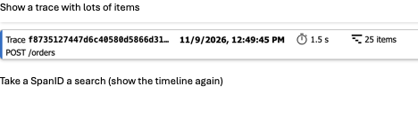

# M4 demo: presenter guide

Use the same run for slide 41 (reliability) and slide 49 (Application Insights).
For prerequisites and one-time Azure setup, see [the full runbook](./DEMO.md).

## 1. Start the demo

From the repository root, start the local dependencies:

```bash
docker compose -f infra/docker-compose.yml up -d
```

Open two Bash terminals. Run only one copy of each role.

**Terminal 1: Payments** (leave it running):

```bash
cd src/M4.ReliableOrders
./run-demo.sh asb --role payments
```

**Terminal 2: Orders** (type all demo keys here):

```bash
cd src/M4.ReliableOrders
./run-demo.sh asb --role orders
```

Wait for both processes to start. Note the time for the Application Insights
time-range filter. Use `rabbit` in both commands to demonstrate the other broker.

## 2. Run the scenarios (slide 41)

Type each key in **Orders**, then press Enter. Wait for the outcome before continuing.
The key guide reappears after each command, but message processing is asynchronous.

| Key | What it does | What to show | What to say |
|---|---|---|---|
| **w** | Sends 60 mixed orders over roughly two minutes. | Traffic, failures and Application Map activity. Includes happy, transient and permanent failures, not duplicates or crashes. | "This fills our telemetry with mixed traffic. We will demonstrate duplicates and crashes separately." |
| **ENTER** | Places a happy-path order. | Pending -> Paid. Copy the OrderId for the end-to-end walkthrough. | "A command goes to one owner; an event announces the result. Pending first, Paid later: eventual consistency." |
| **x** | Deliberately crashes Orders after the SQL commit. | Restart **Orders**; the outbox retains the command and the order becomes Paid. The fatal-error stack trace is expected. | "The order and command committed together. Even when Orders crashes, the outbox remembers what still needs sending." |
| **d** | Sends the same ChargePayment twice with the same MessageId. | Payments logs "Duplicate message ... skipped"; only one payment is recorded. | "At-least-once delivery means duplicates are possible. The inbox makes processing the same message again a no-op." |
| **k** | Starts a 15-second payment. | When Payments says "close this window NOW", terminate Payments abruptly before it finishes, then restart **Payments**. Show redelivery and recovery. Allow for the 30-second Service Bus lock; RabbitMQ redelivers after disconnect. | "The worker died before acknowledging. The broker redelivers, and the uncommitted database work rolls back so processing can recover." |
| **t** | Simulates a transient timeout. | Three immediate failures -> delayed retry about five seconds later -> Paid. | "Will retrying help? Yes, later. Immediate retries handle brief glitches; delayed retries give a dependency time to recover." |
| **f** | Simulates a permanent card decline. | Fail fast -> PaymentFailed -> Failed; original command goes to `m4-error`. | "A declined card is a business outcome, not a temporary outage. Repeating the same charge attempt will not fix it." |
| **r** | Re-drives the error queue for about ten seconds. | Transient failures return for processing; permanent failures move to `m4-error-parked`. | "An error queue needs an owner and a runbook. Retry recoverable failures; park permanent ones for a human." |
| **s** | Lists the latest ten orders. | Pending, Paid and Failed statuses. | "These are the business outcomes, not just successful message deliveries. Check that each order reaches its expected final state." |
| **q** | Stops Orders normally. | Normal shutdown, not the crash demonstration. | "This is a normal shutdown. It is different from the abrupt failures we deliberately demonstrated." |

Suggested sequence: **w -> ENTER -> x -> d -> k -> t -> f -> r**.
Use **s** to confirm outcomes.

### Restart the correct role

After **x**, run in the Orders terminal:

```bash
./run-demo.sh asb --role orders
```

After terminating Payments during **k**, run in the Payments terminal:

```bash
./run-demo.sh asb --role payments
```

**Address already in use** on port **5181** means Payments is already running;
port **5180** belongs to Orders. Do not start a second copy.

For **k**, do not rely on Ctrl+C: graceful shutdown can wait for the handler to
finish and miss the crash scenario. Terminate the Payments process abruptly
(for example, stop that specific process in Activity Monitor or Task Manager).
This intentionally simulates a crash; do not terminate Orders or other processes.

### Code to show

- [PlaceOrder.cs](./M4.Orders/PlaceOrder.cs): order + command outbox in one SQL transaction.
- [ChargePaymentHandler.cs](./M4.Payments/ChargePaymentHandler.cs): inbox + payment row + event outbox in one SQL transaction.
- [Payments Program.cs](./M4.Payments/Program.cs): retry tiers and fail-fast configuration.
- [ChargePaymentFailedHandler.cs](./M4.Payments/ChargePaymentFailedHandler.cs): delayed retry or permanent failure.

## 3. Follow one complete transaction (slide 49)

1. Use the happy-path OrderId saved above, or press **ENTER** for a fresh order.
2. Confirm **Paid**. Allow **1-3 minutes** for telemetry ingestion.
3. Open **Application Insights -> Transaction search**. Select a time range
   beginning after startup and search for the OrderId.
4. Open a matching "Order ... placed by alice" or "Order ... is Paid" log.
   Select **End-to-end transaction details**.
5. Expand the timeline and show both roles:

```text
POST /orders
  -> Orders: order + ChargePayment saved to SQL outbox
  -> Service Bus: ChargePayment delivered to Payments
  -> Payments: inbox + payment + PaymentCharged saved to SQL outbox
  -> Service Bus: PaymentCharged delivered to Orders
  -> Orders: status updated to Paid
```

### Example transaction entry



This is the supplied example trace entry: **POST /orders**, **1.5 s**, **25 items**.
Open the trace to inspect its timeline. Duration and item count vary by run;
25 items does not mean 25 orders. The trace ID is not the business OrderId.

If Transaction search does not find the order, run this in **Logs**:

```kusto
traces
| where timestamp > ago(2h)
| where message contains "PASTE-ORDER-ID-HERE"
| project timestamp, message, cloud_RoleName, operation_Id
| order by timestamp asc
```

Matching `operation_Id` values connect telemetry across both roles. Query 1 in
[queries.kql](./queries.kql) gives a chronological table for one order.

## 4. Explain the observability views

| View | What to show |
|---|---|
| **Application Map** | Orders, Payments, local SQL and Azure Service Bus dependencies. |
| **End-to-end transaction** | One order across both roles, with Rebus, SQL and broker operations. |
| **Failures** | Transient timeouts versus permanent card declines. Red edges can be expected from these scenarios. |
| **Logs** | Duplicate detection, retry attempts and structured OrderId fields. Use queries 3 and 5 for duplicates and good versus bad logging. |

Map labels are instrumentation layers, not separate messaging systems:

- **REBUS:** logical framework operations, such as send and handler execution.
  A `ChargePayment process` node is not a separate deployed service.
- **SERVICEBUS:** native SDK operations against queues, topics and the namespace.
- **HTTP:** typically Service Bus startup administration calls, not AMQP message delivery.
- **SQL / localhost:** business, inbox and outbox database operations.

Select a time range after startup to exclude initialization traffic. Successful
background outbox polls are filtered, but failed polls and business SQL remain.
Map call counts count operations, not orders.
